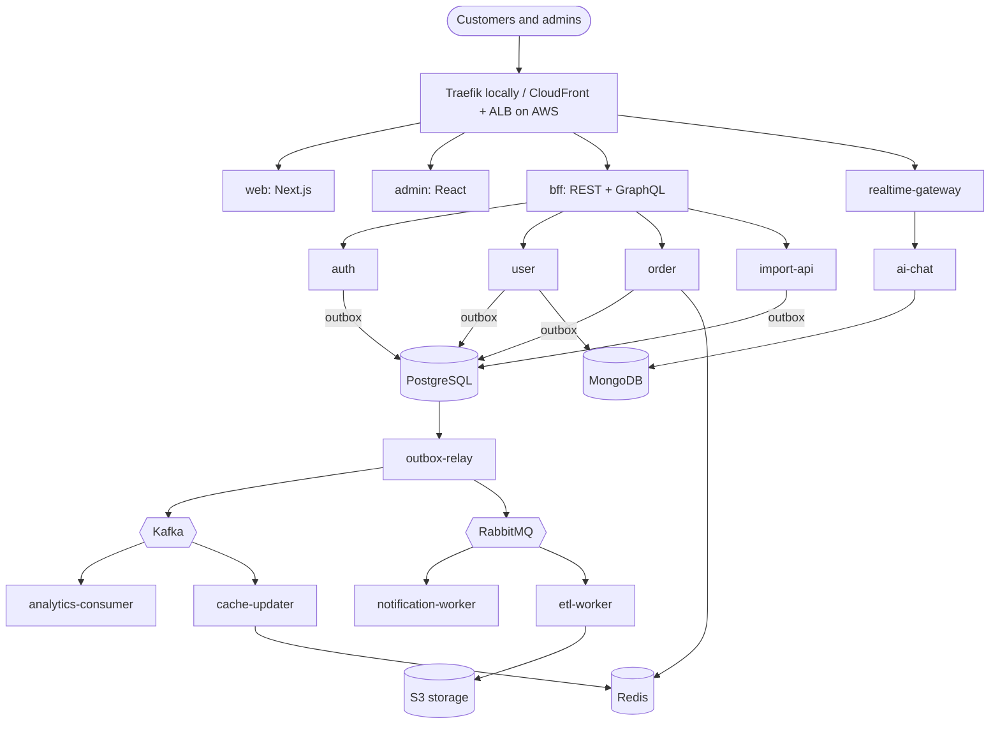

# ShopSphere

A production-style e-commerce platform built as a learning project: **Next.js** and **React** frontends,
**Node.js** and **Python** microservices, **GraphQL**, **Kafka**, **RabbitMQ**, **BullMQ**, **PostgreSQL**,
**MongoDB**, **Redis**, S3 file imports, an AI chatbot with RAG, and full observability, deployable to
**AWS ECS or EKS**.

> **Docker:** everything about running the infrastructure and containers is in
> **[infra/docker/README.md](infra/docker/README.md)**.

---

## Architecture



## Repository layout

```text
apps/
  web/                    Next.js customer app                          :3000
  admin/                  React + Vite admin dashboard                  :5173
services/                 one folder per deployable service
  bff/                    Express BFF (REST + GraphQL)                  :4000
  auth/                   Auth & identity                               :4001
  user/                   User profiles                                 :4002
  order/                  Catalog & orders                              :4003
  realtime-gateway/       Socket.IO gateway                             :4004
  outbox-relay/           worker: outbox -> Kafka / RabbitMQ            health :9100
  notification-worker/    worker: RabbitMQ + BullMQ emails              health :9101
  analytics-consumer/     worker: Kafka -> analytics read models        health :9102
  cache-updater/          worker: Kafka -> Redis cache invalidation     health :9103
  import-api/             FastAPI, file imports (Python)                :8001
  etl-worker/             worker: import processing (Python)            health :9104
  ai-chat/                FastAPI, RAG chatbot (Python)                 :8000
packages/                 shared TypeScript packages
  service-kit/            config, logging, health, errors, graceful shutdown for every Node service
  logger/                 pino logger with redaction
  contracts/              event envelope, topic and queue names
  tsconfig/               shared compiler settings
python-libs/shared/       shopsphere_shared: the same building blocks for the Python services
infra/docker/             Docker Compose, Dockerfiles, Traefik, init scripts  -> see its README
docs/
  adr/                    architecture decision records
  course/                 course books (PDF)
.github/                  CI workflow, Dependabot
```

## Prerequisites

| Tool | Version | Notes |
| ---- | ------- | ----- |
| Node.js | 22 (see `.nvmrc`) | |
| pnpm | 9 | `corepack enable` installs the right version |
| uv | latest | Installs Python 3.12 by itself |
| Docker Desktop | latest | 6-8 GB memory in Settings -> Resources |

Add `127.0.0.1 shop.localhost admin.localhost` to your hosts file.

## Quick start

```bash
pnpm install                                   # Node workspace
uv sync --all-packages                         # Python workspace (.venv at the root)
cp infra/docker/.env.example infra/docker/.env # local Docker settings (change ports if Postgres/Mongo are installed natively)
pnpm docker:up                                 # databases, Kafka, RabbitMQ, S3 storage (waits until healthy)

cp services/order/.env.example services/order/.env
pnpm dev --filter=@shopsphere/order            # run one service with hot reload
curl http://localhost:4003/health/ready
```

Stop the infrastructure with `pnpm docker:down` (your data is kept).

## Everyday commands

### Code

| Task | Command |
| ---- | ------- |
| Run one Node service / app | `pnpm dev --filter=@shopsphere/order` (or `@shopsphere/web`, `@shopsphere/admin`...) |
| Run all Node services | `pnpm dev --filter=./services/*` |
| Run one Python service | `uv run --package import-api import-api` |
| Typecheck / lint / test / build | `pnpm typecheck`, `pnpm lint`, `pnpm test`, `pnpm build` |
| Python lint / format / tests | `uv run ruff check .`, `uv run ruff format .`, `uv run pytest` |
| Format everything (Prettier) | `pnpm format` |
| Add a Node dependency | `pnpm add <pkg> --filter @shopsphere/order` |
| Add a Python dependency | `uv add --package import-api <pkg>` |

### Docker (full list in [infra/docker/README.md](infra/docker/README.md))

| Task | Command |
| ---- | ------- |
| Core + Kafka + RabbitMQ + S3 | `pnpm docker:up` |
| Whole shop in containers | `pnpm docker:apps` |
| Status / logs | `pnpm docker:ps`, `pnpm docker:logs [service]` |
| Database shells | `pnpm docker:psql`, `pnpm docker:mongo`, `pnpm docker:redis` |
| Stop (keep data) / wipe all data | `pnpm docker:down` / `pnpm docker:wipe` |

## Configuration

- Each service reads its settings **only from environment variables**, validated at start-up
  (`src/config/env.ts` in Node, `settings.py` in Python). A missing setting stops the service with a clear message.
- For local runs, copy the service's `.env.example` to `.env`. `.env` files are git-ignored.
- Docker settings (ports, passwords, Cloudflare R2) live in `infra/docker/.env`.

## Service conventions

Every Node service has the same shape:

```text
src/
  config/env.ts      validated settings (zod); add keys here as the service grows
  config/logger.ts   service logger
  routes/index.ts    mount feature routers here
  app.ts             builds the Express app (also used by tests)
  index.ts           starts the server / worker with graceful shutdown
```

Grow a service by feature: `src/modules/<feature>/` with `*.routes.ts`, `*.schemas.ts`, `*.service.ts`,
`*.repository.ts`. Python services follow the same idea in `src/<package>/` (`settings.py`, `routes.py` or
`worker.py`, `main.py`).

Every service answers `GET /health/live` and `GET /health/ready` (workers on their health port), logs JSON,
returns errors as RFC 9457 Problem Details, and shuts down gracefully on SIGTERM.

### How the pieces fit

- **Shared code, not copied code.** Express setup (helmet, request ids, pino-http, CORS, error handling), health
  checks and SIGTERM handling live in `@shopsphere/service-kit`; Python has the same in `shopsphere_shared`.
- **No build step in development.** Workspace packages export their TypeScript source under the
  `@shopsphere/source` condition (used by `tsx` and the editor) and compiled `dist/` otherwise (builds, images).
- **One lockfile per language:** `pnpm-lock.yaml` and `uv.lock` at the root.

## CI

`.github/workflows/ci.yml` runs on every pull request and push to `main`:

| Job | Checks |
| --- | ------ |
| `node` | Typecheck, lint, test, build (only changed packages on PRs) |
| `python` | Ruff lint + format check, pytest |
| `infra` | yamllint, `docker-compose.yml` validation |
| `images` | Builds all 14 Docker images |

Dependabot (`.github/dependabot.yml`) opens weekly update PRs for npm, uv, Docker images and GitHub Actions.

## Deployment (AWS ECS / EKS)

The images in `infra/docker/images/` follow the runtime contract cloud platforms expect:

| Concern | What the services do | What to configure on AWS |
| ------- | -------------------- | ------------------------ |
| Config & secrets | Env vars only, validated at start-up | ECS `environment` / `secrets` from Secrets Manager; k8s ConfigMap / Secret |
| Health | `/health/live` (process), `/health/ready` (dependencies, 503 while stopping) | ALB target group + ECS health check -> `/health/ready`; k8s liveness -> `/live`, readiness -> `/ready` |
| Shutdown | SIGTERM -> readiness 503 -> optional drain (`SHUTDOWN_DRAIN_MS`) -> finish requests -> close clients, within `SHUTDOWN_TIMEOUT_MS` (25 s) | ECS `stopTimeout` >= 30 s; EKS `terminationGracePeriodSeconds: 30` and `SHUTDOWN_DRAIN_MS=5000` |
| Load balancer | Keep-alive 65 s (> ALB idle timeout 60 s); `TRUST_PROXY_HOPS` for client IPs | `TRUST_PROXY_HOPS=2` behind CloudFront + ALB |
| Logs | JSON to stdout with `service` and `requestId` | `awslogs` driver / Fluent Bit |
| Security | Non-root numeric UID (1000 Node, 10001 Python, 101 nginx), no writes to disk | `readonlyRootFilesystem: true`, `runAsNonRoot: true` |

The full walkthrough is in the AWS book below.

## Course books (`docs/course/`)

| Book | Covers |
| ---- | ------ |
| [ShopSphere-Course.pdf](docs/course/ShopSphere-Course.pdf) | Architecture, databases, security, business logic, scale, resilience, release strategies |
| [ShopSphere-Code-Guide.pdf](docs/course/ShopSphere-Code-Guide.pdf) | Step-by-step function code for every service and how they work together |
| [ShopSphere-AWS-Deployment.pdf](docs/course/ShopSphere-AWS-Deployment.pdf) | ECS / EKS, networking, data services, blue-green and canary on AWS, DR, cost |
| [ShopSphere-Docker-YAML.pdf](docs/course/ShopSphere-Docker-YAML.pdf) | YAML, Dockerfiles, Compose, Traefik, GitHub Actions and Kubernetes, line by line |
| [docs/adr/](docs/adr/) | Architecture decision records |
